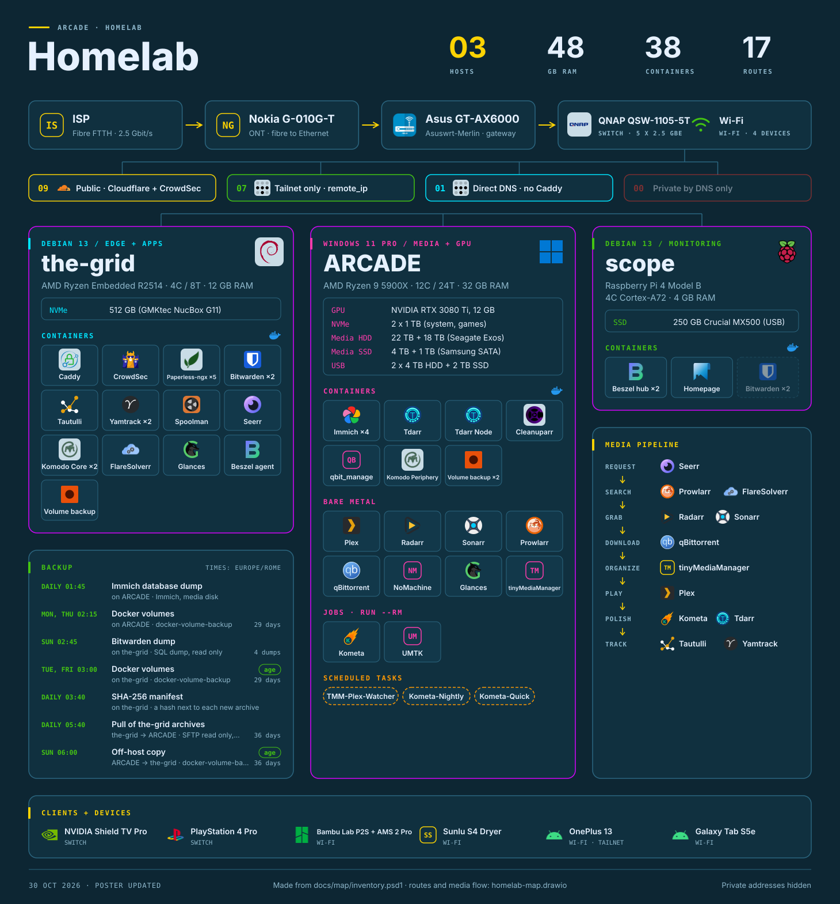
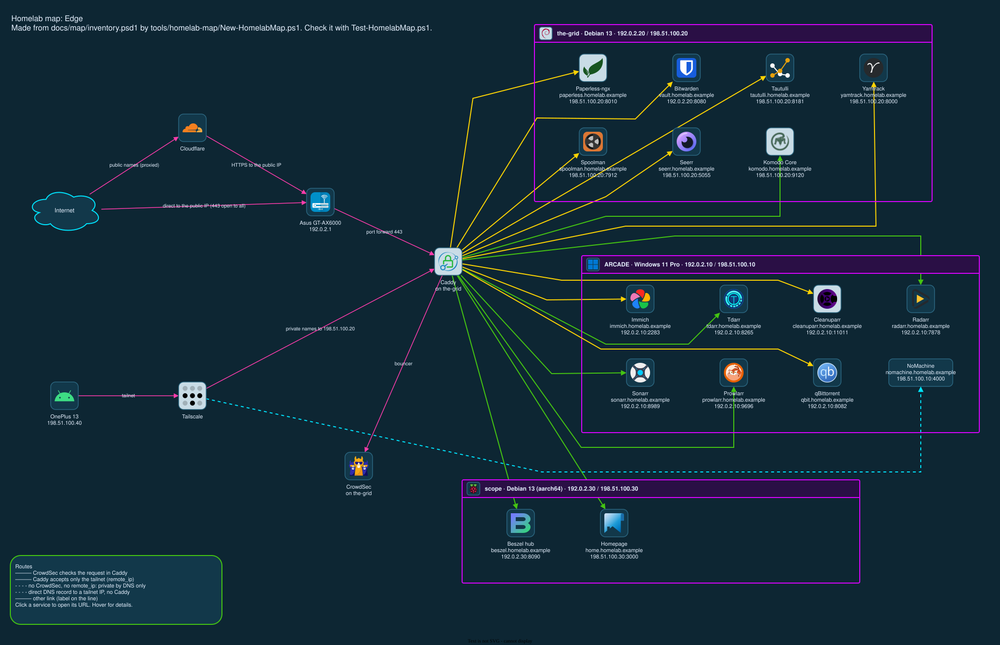
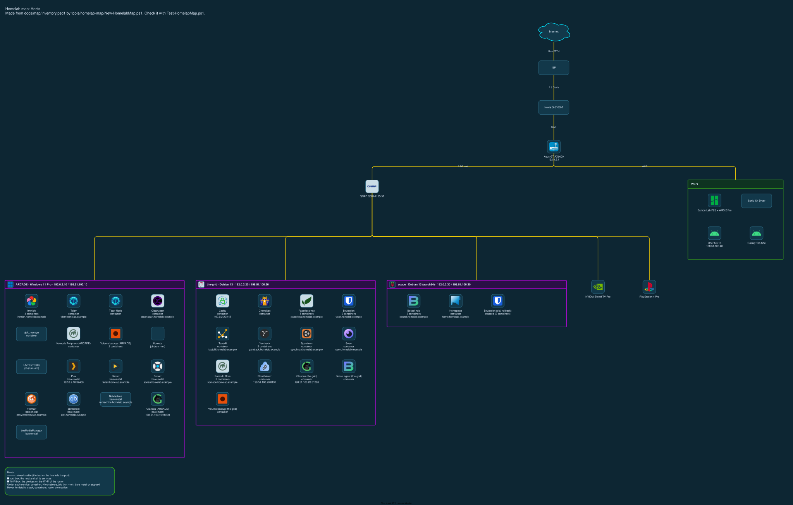
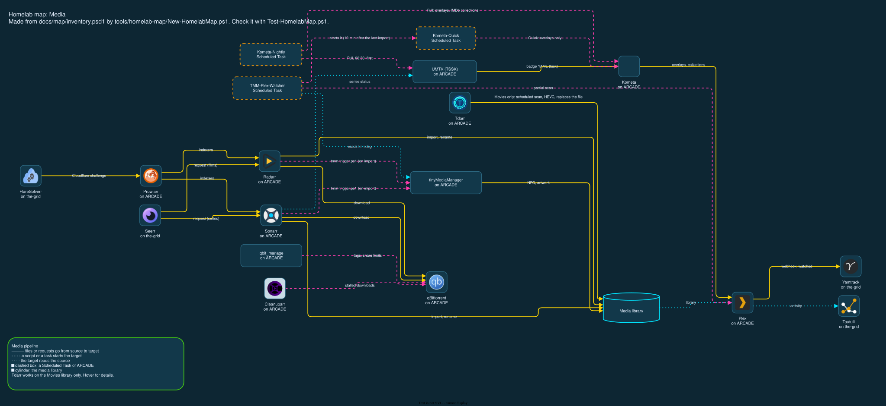

# Homelab map

The map shows the homelab as a poster and as a draw.io drawing. The data comes from one inventory
file. A test script compares the inventory, the poster and the drawing with the real homelab, so
the map cannot become old without a warning.

Status on 2026-10-26: the **poster** gives all the homelab on one page. The pages **Edge**,
**Hosts** and **Media** of the drawing give the details: the routes, the network tree and the media
flow. Faginux arranged the page Edge by hand (M4). All use the synthwave theme (read *Theme*). Read
`PIANO-MAPPA-HOMELAB.md`.









## Files

| File | Content |
|---|---|
| `inventory.psd1` | The source of the map: hosts, devices, services, containers, routes, links and layout. Change this file first. |
| `homelab-map.drawio` | The drawing. Open it with draw.io Desktop. Each item has the custom property `map_id`. |
| `homelab-map-edge.svg`, `homelab-map-hosts.svg`, `homelab-map-media.svg` | The export of each page. `tools/homelab-map/Export-HomelabMap.ps1` makes them. |
| `homelab-poster.svg` | The poster. `tools/homelab-map/Export-HomelabPoster.ps1` makes it from the inventory. `Export-HomelabMap.ps1` runs it too. Do not change it by hand. |
| `icons/` | The icons of the drawing, and `icons.psd1` with the source and the pinned commit of each icon. |

The scripts are in `tools/homelab-map`. Read `tools/homelab-map/README.md`.

## How to read the page Edge

The page shows the path of a request from a client to a service. The clients and the edge nodes
are on the left. Caddy on the-grid is in the centre. Each host has a lane on the right, with the
services that have a route.

Faginux arranged this page by hand (2026-10-21). Do not run `New-HomelabMap.ps1 -Force -View Edge`:
it makes the page again and deletes his layout.

| Line | Meaning |
|---|---|
| Yellow, solid | Public route. Cloudflare is the proxy, and CrowdSec checks the request in Caddy. |
| Green, solid | Private route. The DNS record points to the Tailscale IP of the-grid, and Caddy accepts only the tailnet (`remote_ip 100.64.0.0/10`). |
| Red, dashed | Private by DNS only: Caddy has no `remote_ip` and no CrowdSec for this route. No route has this colour since 2026-10-20 (F1). The test gives a warning for each new one. |
| Cyan, dashed | Direct DNS record to a Tailscale IP. Caddy is not in the path. |
| Pink, with a label | Other link, for example the port forward of the router. |

A purple box is a host, with the services that have a route.

Put the pointer on an item to read its details: host, stack, containers, route and notes. Click
a service to open its URL.

## How to read the page Hosts

The page shows the network as a tree, from the top: the internet, the ISP (fibre FTTH,
2.5 Gbit/s), the ONT (Nokia G-010G-T), the router, then the switch and the Wi-Fi, then the devices
on the switch. The links with `View = 'Hosts'` give the chain above the router. Each server is a box with all its services, not only
the services with a route. The `Uplink` keys of the inventory give the tree.

| Item | Meaning |
|---|---|
| Yellow line | A network cable. The text on the line tells the port, for example `2.5G port`. |
| Purple box | A host: its OS and its addresses (LAN / Tailscale), with all its services. |
| Green box Wi-Fi | The devices on the Wi-Fi of the router. They have no line. |
| Text under a service | `container`, `N containers`, `job (run --rm)`, `bare metal` or `stopped`, then the route or the endpoint. |

The lines go from the bottom of the parent to the top of the child, with right angles, so they do
not cross. The page has no `Layout` block in the inventory: the script calculates the places.

## How to read the page Media

The page shows the media pipeline from left to right: from a request in Seerr to the film in
Plex. The links with `View = 'Media'` in the inventory give the page. The layout `horizontalFlow`
of draw.io puts the items in place.

| Item | Meaning |
|---|---|
| Yellow solid line | Files or requests go from the source to the target. |
| Pink dashed line | A script or a Scheduled Task starts the target. |
| Cyan dotted line | The target reads the source. |
| Orange dashed box | A Scheduled Task of ARCADE. The test checks that it exists and that it is not disabled. |
| Cyan cylinder | The media library: the film and series folders. |

Tdarr is a side branch on the library. It works on the library Movies only (decision of Faginux),
with an hourly scan for new files. Since 2026-10-20 "Hold Files After Scanning" keeps each new
file 30 minutes before the queue. Thus Tdarr works on a file after TMM and the scan of Plex.

## How to read the poster

The poster is one page, from the top:

| Part | Content |
|---|---|
| Header | The number of server hosts, their RAM, the containers and the routes. |
| Network | The chain to the router (the ISP, the ONT), the router, then the switch and the Wi-Fi. The `Detail` key of each item gives the second line. |
| Access | One chip for each kind of route, with the number of routes. The colours are the colours of the lines on the page Edge. |
| Host cards | One card for each server: OS, role, CPU and RAM, disks, then the services by kind (containers, bare metal, jobs, Scheduled Tasks). `×N` is the number of containers. A dashed, pale tile is a stopped service (a rollback copy). |
| Backup | Under the-grid (`Layout.Poster.BackupUnder`): the backup jobs of `Backups` in the inventory, with the time, the hosts, the retention and `age` for an encrypted copy. The data comes from `CALENDARIO-OPERAZIONI.md`. |
| Media pipeline | The steps from a request to the film in Plex (`Layout.Poster.Pipeline` in the inventory). The page Media gives each link. |
| Clients + devices | The devices on the switch and on the Wi-Fi. |

The poster in the repo is **public** (2026-10-26): it shows no IP address and no path. Read
`PIANO-REPO-PUBBLICO.md`. For a private copy with the LAN and tailnet addresses, run
`./tools/homelab-map/Export-HomelabPoster.ps1 -ShowAddress -OutputPath <file outside the repo>`.
Do not commit that copy.

When a backup job changes, change `CALENDARIO-OPERAZIONI.md` and `Backups` in the inventory in the
same commit. The test gives a warning when the `CalendarKey` of a job is not in the calendar.

The hardware facts are in the inventory (`Hardware` of each server). They do not change by
themselves: when you change a disk or the RAM, change the inventory.

## Theme

Since 2026-10-21 the three pages use one theme: neon colours on the dark background `#0D2633`
(synthwave). Faginux chose the background and the main colours. The poster uses the same theme
(2026-10-26). The colours are in `$script:Theme` in `tools/homelab-map/HomelabMap.psm1`.

| Colour | Use |
|---|---|
| Yellow `#FCD303` | Main lines: public routes, network cables, media flow. Page titles. |
| Pink `#FF3CAC` | Secondary lines: other links on the page Edge, scripts and tasks that start a target on the page Media. |
| Orange `#FC9803` | Scheduled Tasks only. |
| Green `#44C412` | Routes for the tailnet only. Border of the Wi-Fi box and of the legend. |
| Purple `#D703FC` | Border of a host box. |
| Cyan `#00E5FF` | Direct DNS records, reads, the media library. |
| Red `#FF3B30` | A risk: a route that is private by DNS only. |

Each icon is on a dark tile. A dark icon gets a light tile (`Tile = 'light'` in
`icons/icons.psd1`). To change a colour:

1. Change the value in `$script:Theme`.
2. Run `./tools/homelab-map/New-HomelabMap.ps1 -Restyle`. The script changes the colours and the
   labels on the three pages. It does not move an item and does not change the bend points of a
   line.
3. Run the export and the test (steps 8 and 9 of the procedure below). The export also makes the
   poster again with the new colours.

## Procedure: change the map

Do these steps on ARCADE, in the directory of the repo.

1. Change `docs/map/inventory.psd1`.
2. Run the test:

   ```powershell
   ./tools/homelab-map/Test-HomelabMap.ps1 | Format-Table -Wrap
   ```

   Each line is a difference between the inventory, the drawing and the real homelab.
3. Run the generator:

   ```powershell
   ./tools/homelab-map/New-HomelabMap.ps1
   ```

   The script adds the missing items in one row below each page. It does not move the items
   that are there. A missing page gets a full layout. `-Force -View Hosts` makes only the page
   Hosts again: the changes by hand on the other pages stay.
4. Open `docs/map/homelab-map.drawio` in draw.io Desktop.
5. Move the new items into their lane.
6. Delete the items that the test shows as "in the drawing, not in the inventory".
7. Save the drawing.
8. Run the export. It writes the SVG of each page and the poster:

   ```powershell
   ./tools/homelab-map/Export-HomelabMap.ps1
   ```

9. Run the test again. Only the known findings must stay (read the next section).
10. Commit `inventory.psd1`, `homelab-map.drawio` and the SVG files in the same commit.

A change that the drawing does not show (a disk, the RAM, a step of the pipeline) needs only steps
1, 8, 9 and 10: the poster comes from the inventory, not from the drawing.

Do not delete or change the property `map_id` (draw.io: select the item, then Edit Data, Ctrl+M).
A copy of an item in draw.io also copies its `map_id`. The test shows a duplicate `map_id` as a
warning.

When you move a line in draw.io, do not release an end of the line in an empty area. The end
disconnects from its item: the line stays on the page, but it does not move with the item. Make
sure that the end of the line shows a blue outline on the item before you release it. The test
shows a disconnected line as a warning ("the edge connects ...").

## Known findings (2026-10-20)

The first full run of the test gave 7 warnings and 0 errors. Faginux closed both findings on the
same day. Since then the test gives 0 warnings.

| Check | Item | Finding | Closed |
|---|---|---|---|
| EXPOSURE (F1) | `seerr`, `radarr`, `sonarr`, `prowlarr`, `tdarr`, `beszel` (`.homelab.example`) | The route was private by DNS only. Port 443 of the router goes to Caddy for all clients. A client that sent one of these names to the public IP got the backend, with no CrowdSec. Radarr, Sonarr and Prowlarr read `X-Forwarded-For` for their local-address bypass, thus such a client got the login page, not the application. | `remote_ip` on the six routes and on `immich` (`ddad0b8`). From outside the tailnet: 404. |
| DNS (F2) | `immich.homelab.example` | The Caddyfile said "DNS only" for the uploads above 100 MB, but Cloudflare proxied the name. | Faginux changed the record to DNS only, to the Tailscale IP of the-grid. |

Change of 2026-10-27: Faginux opened `immich` (DNS only, public IP, no `remote_ip`) and `seerr`
(Cloudflare proxy, CrowdSec) to the Internet. `spoolman` got `basic_auth`. Seven routes stay
`tailnet-enforced`. The test still gives 0 warnings.

The details are in `PIANO-MAPPA-HOMELAB.md`, section *Findings*.

## Icons

The icons come from two repositories, at a pinned commit:

- [loganmarchione/homelab-svg-assets](https://github.com/loganmarchione/homelab-svg-assets) (MIT for the code)
- [homarr-labs/dashboard-icons](https://github.com/homarr-labs/dashboard-icons) (Apache-2.0), the source of Homepage

Each icon is a trademark of its owner. The licence of each source is in `icons/icons.psd1`.
`Sync-HomelabMapIcon.ps1` downloads the icons and rejects an SVG with active
content (script, event handler, external link).
